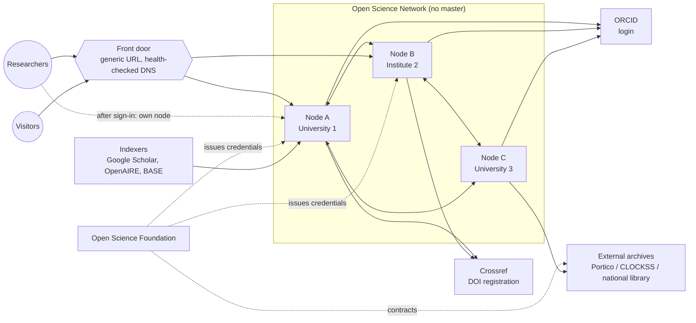
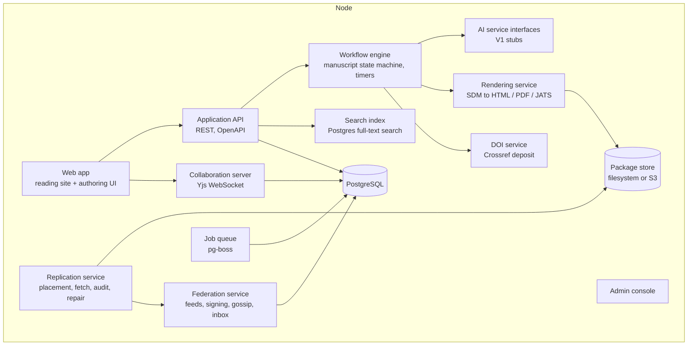
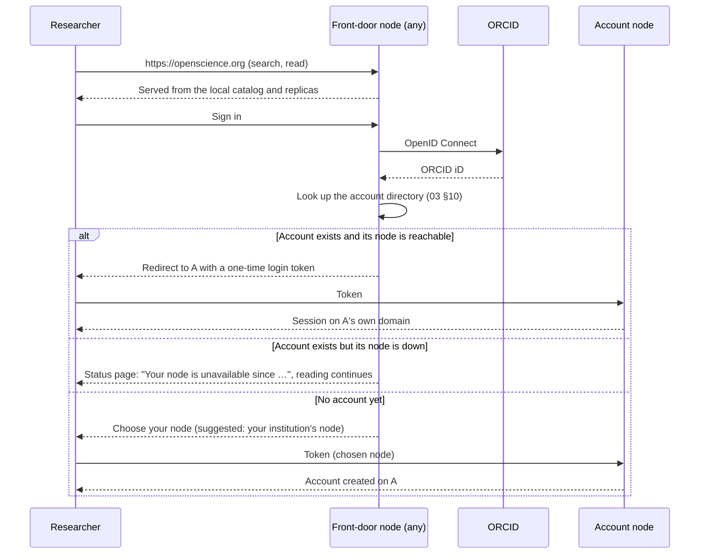

# 02 — Architecture and Tech Stack

## 1. System context

Every node runs the same software and offers the full feature set: authoring, editorial workflow, reading site, search and federation. Nodes differ only in which users they host, which manuscripts they handle and which publication replicas they store.

## 2. Three kinds of data

Data falls into three classes, with different storage and replication rules. This separation answers the question of how publications are managed differently from transactional data.

| Class | Examples | Storage | Replication | Mutability |
|---|---|---|---|---|
| **Transactional (private)** | User sessions, email addresses, drafts, manuscripts under review, invitations, reviews before publication, confidential comments, reports | PostgreSQL on the handling or account node | Not readable anywhere else. Encrypted, restore-only copies on **2 partner nodes** (V1), and automatic takeover by a partner in V2 (03 §11). | Mutable |
| **Network state (public, small)** | Node membership and keys, admission votes, editorial boards, reviewer-pool profiles, catalog entries (metadata, abstract, full text for search), replica announcements | Signed per-node **feeds**, materialised into PostgreSQL tables on every node | **Every node holds everything** (gossip) | Append-only. Current state is derived from the events. |
| **Publication content (public, large)** | Rendered HTML, PDF, JATS, source, figures, supplementary files, all versions and review history | **Content-addressed package store** (filesystem or S3-compatible) | **R copies**, placed by rendezvous hashing, plus voluntary mirrors | Immutable. A correction creates a new package. |

The rules that follow:

- The database never holds the only copy of anything public. Every node can rebuild public state from the feeds, and fetch any package from its replicas.
- A package is identified by its hash, so any copy can be verified independently of the node it came from.
- Per-publication data that changes, such as the replica list, the latest version or a retraction, is not stored inside the package. Every node derives it from the feeds (see 04).

## 3. Components of a node

| Component | Responsibility |
|---|---|
| Web app | Public reading site (server-rendered for search engines and speed), plus the logged-in application: dashboard, editors, review forms and admin. |
| Application API | All user-facing operations, with role and permission checks. Documented with OpenAPI, so other clients can be built. |
| Collaboration server | Real-time co-editing of manuscripts with Yjs documents. Saves snapshots to PostgreSQL. |
| Workflow engine | The manuscript state machine (see 05): transitions, deadlines, reminders and an audit trail. |
| Rendering service | Deterministic conversion of the document model to HTML, PDF and JATS. Runs sandboxed. The renderer version is recorded in each package. |
| Federation service | Holds the node keys, signs and publishes feed events, syncs feeds with peers, verifies incoming events, maintains derived tables, and runs the signed inbox for targeted messages. |
| Replication service | Computes placement, fetches and verifies packages, announces replicas, runs storage audits and repairs. |
| Search | PostgreSQL full-text search over the whole catalog, with language-specific configurations. An external engine is optional at scale. |
| Job queue | Background jobs (pg-boss, which runs on PostgreSQL, so no separate broker is needed). |
| AI interfaces | `FormalCheckService`, `ReviewerRecommender` and `ReviewAssistant`. V1 ships the stub or simple implementations (see 05 §8). |
| DOI service | Builds Crossref deposit XML from the package manifest, submits it, and tracks the result. |
| Admin console | Node setup, admission votes, health, replication status, user reports, backups, updates. |

## 4. Tech stack

### 4.1 Selection criteria

1. **Ease of installation and operation** for a university IT department (D-13). This matters most.
2. **Fit for the hard parts**: real-time collaborative editing, math rendering, document conversion, cryptographic signing, and long-running background work (gossip, replication).
3. **One language across browser and server where possible**. The editor, math rendering and LaTeX parsing must run in both places and produce identical results.
4. A large developer pool and a long-term ecosystem (the project will see contributors change over the years).

### 4.2 Is PHP a good choice?

PHP (with Laravel) is a reasonable choice for a classic web application. It is easy to host, well known at universities, and Laravel has queues, authentication and WebSockets (Reverb). For this system, however, it isn't the best fit:

- **The hardest parts of the product live in the JavaScript ecosystem.** Collaborative editing (Yjs, ProseMirror/Tiptap, CodeMirror), math rendering (KaTeX, Temml, MathLive) and LaTeX parsing (unified-latex) are JavaScript libraries. Server-side rendering of the final document has to produce exactly what the author saw in the browser preview. With PHP, every node would run PHP *and* a Node.js sidecar, which means two runtimes and two dependency chains for administrators.
- **Federation, gossip, replication and the collaboration server are long-running processes.** PHP's request–response model handles them through extra daemons, which work but add operational complexity.
- **Scaling isn't the deciding factor.** Each node serves one institution's researchers and readers. The network grows by adding nodes, not by making one node large. PHP, Node.js and Go all scale far beyond what one node needs.

### 4.3 Decision: TypeScript throughout, delivered as one container stack

Confirmed as D-14 on 2026-11-15. The PDF engine is the only part still open; it is chosen after spike S1.

| Layer | Choice | Reason |
|---|---|---|
| Language | **TypeScript** on the current Node.js LTS | One language for browser and server. The editor schema, the LaTeX-subset parser and the renderers are shared code, so preview and published output match. |
| Backend framework | **NestJS** (on Fastify) | Structured modules, dependency injection, OpenAPI generation, guards for permissions. Fits a long-lived project with changing contributors. |
| Frontend | **React** with server-side rendering for public pages (Next.js or Remix-style SSR within the same deployment) | Fast, indexable public pages, plus a rich application UI. |
| Rich-text editor | **Tiptap** (ProseMirror) with a custom schema | Mature structured editor with a schema that maps one to one onto the document model. |
| LaTeX editor | **CodeMirror 6** with a LaTeX language mode | Lightweight, extensible, with collaborative editing support. |
| Collaboration | **Yjs** with **Hocuspocus** server | CRDT-based real-time collaboration for both editors. MIT licensed. |
| Math | **KaTeX** (live preview), **Temml** (LaTeX to MathML for HTML/JATS), **MathLive** (visual math input) | Fast, accurate, all JavaScript. |
| LaTeX parsing | **unified-latex** | Parses LaTeX to an AST, so the subset can be validated and converted. |
| PDF | **Typst** (embedded CLI), with LaTeX-math-to-Typst conversion (for example via mitex) | Fast, deterministic, sandboxed, a single small binary instead of a 4 GB TeX installation. *Open: compared against HTML-to-PDF (Paged.js plus headless Chromium) in Phase-0 spike S1; the result is recorded here.* |
| Import (V2) | **Pandoc** | Standard DOCX and LaTeX conversion. |
| Database | **PostgreSQL** | Relational integrity for the workflow, JSONB for documents and events, built-in full-text search, and the job queue (pg-boss). |
| ORM / migrations | **Drizzle** or **Prisma** | Typed schema with migrations. |
| Package store | Local filesystem by default, any **S3-compatible** store optionally | Simple default. Institutions with object storage can plug it in. |
| Cryptography | Node.js `crypto` (Ed25519), RFC 8785 JSON canonicalisation, RFC 9421 HTTP Message Signatures | Standard primitives, no exotic dependencies. |
| Reverse proxy / TLS | **Caddy** | Automatic HTTPS certificates, simple configuration. |
| Packaging | **Docker Compose**: `app` (API, web, workers, collaboration, renderer), `postgres`, `caddy` | Three containers. One command to install, one to upgrade. A Helm chart for Kubernetes users can follow. |

### 4.4 Alternatives considered

| Option | For | Against | Verdict |
|---|---|---|---|
| PHP / Laravel | Easy shared hosting, familiar to many | Needs a Node.js sidecar for editor, math and rendering. Long-running federation work is awkward. | Possible, not recommended |
| Python (Django / FastAPI) | Strong for AI work (V2), Django admin | Same sidecar problem for editor and math. | Good choice for a separate **AI service** in V2 |
| Go | Single static binary, excellent for networking and operations | Frontend and editor stay TypeScript, so two languages. Smaller ecosystem for document tooling. | Strong alternative if the team prefers Go |
| Java / Kotlin (Spring) | Robust, common at universities | Heavy runtime, slower iteration, same frontend split. | Not recommended |

The AI features in V2 SHOULD run as a separate Python service behind the AI interfaces, so model work can use the Python ML ecosystem without affecting the core node.

## 5. Deployment

### 5.1 Requirements per node

- One Linux VM: 4 vCPU, 8 GB RAM, 250 GB disk to start (sizing in 04 §9).
- A public DNS name (for example `osn.uni-example.de`) with ports 80 and 443 reachable.
- An outgoing SMTP relay for email.
- An ORCID public API client registered for the node's domain (free; the installer explains the steps).
- Foundation membership and the Crossref deposit credentials issued by the Foundation (needed before the node can publish).

### 5.2 Installation flow

1. `curl -fsSL https://get.<project>.org | sh`, or download the release and run `osn install`.
2. The installer asks for the domain, admin email, SMTP and ORCID client, writes `.env`, generates the **node key pair** (see 03), and starts the stack.
3. The admin opens the console, enters the institution's details and either creates the network (genesis, first node only) or applies to join an existing one, by entering any member node's URL.
4. While the application is pending, the node runs in **pending mode**: it syncs public feeds read-only and can show the catalog, but cannot publish, host editors, or store replicas.

### 5.3 Operations

- **Upgrades**: `osn upgrade` pulls signed release images, takes a database backup, runs migrations and restarts. Releases are signed by the project's release key.
- **Backups**: two independent layers. (1) The institution's own nightly backup to a target of its choice (local or S3). (2) Continuous encrypted partner copies on 2 other nodes (03 §11). Restoring from either is documented and tested in CI.
- **Monitoring**: a `/healthz` endpoint, Prometheus metrics, and an admin dashboard showing feed lag per peer, replication health, job queue, disk usage and certificate expiry.
- **Scaling one node**: the `app` container is stateless apart from the database and package store, so several instances can run behind Caddy if one institution needs it.

## 6. Front door (generic URL)

Researchers and readers shouldn't have to know which node to visit. The network therefore has one generic URL (D-15), written here as `https://<network-domain>`, for example `openscience.org`.

### 6.1 How it is served

- The **Foundation owns the domain**, just as it owns the DOI prefix. This is one central element, but legally owned and run on many servers, so no single node controls it.
- A number of **front-door nodes** serve the generic URL. These are ordinary member nodes that volunteer for it, at least 3 in different institutions. A front-door node is a normal node with one extra hostname. It has no extra powers.
- **DNS** for the domain is a managed DNS service with health checks, run by the Foundation and with a secondary provider. It lists every front-door node whose `/healthz` answers, with a TTL of 60 seconds. A node that stops answering drops out of DNS within 5 minutes (NFR-15).
- **TLS**: each front-door node gets its own certificate for the generic domain through the ACME DNS-01 challenge. It uses a Foundation-issued API token that can only write `_acme-challenge` records. HTTP-01 doesn't work here, because the challenge could reach a different node.
- **ORCID**: the Foundation registers one ORCID client for the generic domain, and every front-door node uses it.

### 6.2 What it does

1. **Reading and search** need no fixed node. Every node has the whole catalog and can fetch any package from its replicas. The front door serves home, search, landing pages (`/p/{doi}`) and review histories directly.
2. **Sign-in** happens on the front door with ORCID. The answering node looks up the user's account node in the account directory and redirects to it with a **one-time login token**. The token is signed by the front-door node, valid only for the target node, expires after 60 seconds, and can be used once. The user doesn't have to sign in twice.
3. From then on, the user stays on **their account node's own domain**. All links in emails and dashboards point to specific node domains (the account node, or the handling node of a manuscript). That's how users get the same node every time: through identity and links, not through load-balancer stickiness.
4. **First sign-in**: the front door asks the user to choose an account node. It suggests the member node whose institution matches an affiliation on the user's ORCID record (by ROR ID). Researchers with no matching institution can choose any node that accepts independent researchers.
5. **Account node unreachable**: the front door shows a status page with the time of the outage. Reading and search keep working. Links to manuscripts on *other* handling nodes keep working, because those nodes accept the user's ORCID sign-in directly (03 §10).

### 6.3 DOI resolution

DOIs resolve to `https://<network-domain>/p/{doi}` (04 §7.3). If a node fails, its DOIs keep working right away, because any front-door node can serve any landing page.

## 7. Protocol versioning

- Federation messages carry `protocol: "osn/1"`. Nodes advertise supported versions in `/.well-known/osn`.
- Event types and fields may be **added** within a major version. Unknown fields MUST be preserved and relayed. Unknown event types MUST be stored and relayed, but not interpreted.
- A breaking change raises the major version. Nodes MUST support the current and the previous major version.
