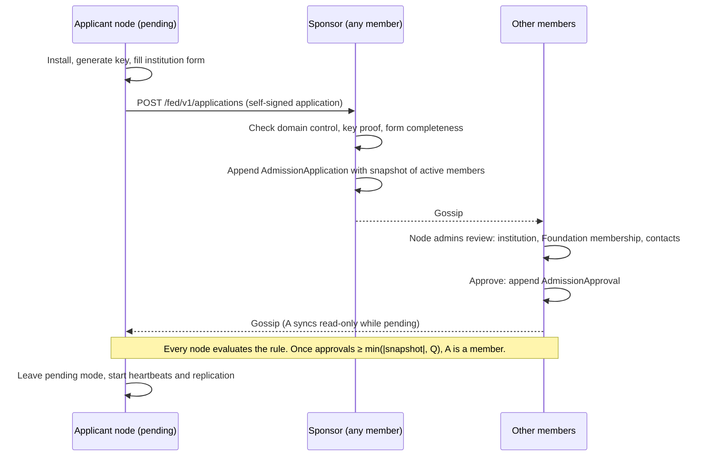

# 03 — Federation and Governance

This document specifies how nodes identify themselves, share public state without a master node, and admit new members.

## 1. Design idea

The network has no central database and no consensus protocol (no blockchain, no leader election). It relies on two properties instead:

1. **Every node publishes only statements about itself, signed with its own key**: "I approve applicant X", "I store package P", "I published DOI D". These go into the node's own append-only **feed**.
2. **All network rules are deterministic functions over those signed statements.** Membership, admissions, editorial boards and replica lists are computed locally by each node from the feeds it holds. Two nodes with the same feeds always compute the same state.

Feeds are replicated to every node by gossip, so all nodes eventually hold the same events and compute the same state. Because the admission rule only ever adds members (D-09: approvals only, no expulsion), the state only grows and never needs conflict resolution. This is what makes "no master" possible with ordinary technology.

## 2. Node identity

| Item | Specification |
|---|---|
| Node key | An Ed25519 key pair generated at installation. The private key is stored encrypted at rest; an HSM or OS keystore MAY be used. |
| Node ID | `osn:node:` followed by the base32 SHA-256 of the public key, for example `osn:node:k3f7…`. Stable for the node's lifetime, even across key rotations (the ID refers to the genesis key of that node). |
| Node code | A short, human-readable, unique code chosen at application, for example `uni-koeln`. Used in DOIs and URLs. Immutable once admitted. |
| Domain | The HTTPS base URL. It can change with a signed `NodeEndpointChanged` event. |
| Node info | `GET https://<domain>/.well-known/osn` returns the node ID, code, current public key, supported protocol versions, institution name and contact. |

A node proves control of its domain by serving the node info document at that domain, signed with its node key.

## 3. Feeds

### 3.1 Structure

Each node keeps one append-only feed. Every entry is an **event**:

```json
{
  "protocol": "osn/1",
  "feed": "osn:node:k3f7…",
  "seq": 1042,
  "prev": "sha256:9b1c…",
  "type": "AdmissionApproval",
  "created": "2027-03-02T10:15:00Z",
  "payload": { "application": "sha256:77ad…", "comment": "Verified Foundation membership." },
  "key": "ed25519:…",
  "sig": "base64…"
}
```

- `seq` increases by exactly 1 per event. `prev` is the hash of the previous event in the same feed. This makes each feed a hash chain.
- The event ID is the SHA-256 of the canonical JSON (RFC 8785) of the event without `sig`.
- `sig` is the Ed25519 signature over the same canonical bytes, made with the node key valid at `seq`.
- Events are never edited or deleted. A correction is a new event that supersedes an earlier one.

### 3.2 Synchronisation

- **Pull**: `GET /fed/v1/feeds` returns the highest `seq` the node holds for every feed it knows about. `GET /fed/v1/feeds/{nodeId}?after={seq}&limit=500` returns events.
- **Gossip**: every 60 seconds, each node pulls from 3 random active peers, and asks for every feed where the peer is ahead.
- **Push hints**: after appending an event, a node sends a small signed `POST /fed/v1/hint` to 5 random peers, so changes spread in seconds instead of minutes.
- **Relaying**: nodes serve the feeds of *other* nodes too. Since every event is signed, it doesn't matter where it comes from. Feeds therefore stay available even if their owner is offline.
- **Verification**: a receiving node MUST check the signature, the `seq` continuity and the `prev` hash before storing an event. Events from non-members are only accepted where the rules allow them (an `AdmissionApplication` relayed by a member, see §5).

### 3.3 Equivocation

If a node is found to have signed two different events with the same `seq` (a forked feed), every node that sees both MUST store both as a **fork proof**, raise an alert on the admin console, and stop accepting new events from that feed until the node's administrator resolves it with a `KeyRecovery` (§6). Forks only happen through bugs, restored backups, or a stolen key.

### 3.4 Heartbeats

Each node appends a `Heartbeat` event at least every 24 hours. Its payload includes its software version, declared storage capacity and current used storage. A member is **active** if its latest known heartbeat is less than 30 days old, and **dormant** otherwise. Dormant members stay members, but they don't count towards quorums or replica placement.

## 4. Event types

| Type | Emitted by | Purpose |
|---|---|---|
| `Genesis` | First node | Creates the network and its initial parameters. |
| `AdmissionApplication` | A member node (the sponsor) on behalf of an applicant | Carries the applicant's self-signed application. |
| `AdmissionApproval` | A member | Approves an application. |
| `AdmissionRejection` | A member | Informational objection with a reason (D-09). Doesn't affect the outcome. |
| `ApplicationWithdrawn` | The sponsor, on the applicant's request | Ends an application. |
| `Heartbeat` | Every member | Liveness and capacity. |
| `NodeEndpointChanged` | The node | New domain. |
| `KeyRotation` | The node | New key, signed with the old key. |
| `KeyRecovery` | A member, for another node | Approves a replacement key after loss or compromise (same quorum as admission). |
| `NodeRetired` | The node | Leaves the network voluntarily. |
| `BoardDefined` / `BoardScopeChanged` | Account node of a board chair (genesis for the founding boards) | Creates a board, or changes the set of subfields it covers (12 §3.1). |
| `TopicExtensionDefined` | Account node of a chair of the responsible board | Adds a board-defined sub-topic below an OpenAlex topic (12 §1.2). |
| `EditorAppointed` / `EditorRemoved` | The node of an approving board chair or editor | Editorial board membership (see 05 §2). |
| `ReviewerProfile` | A researcher's account node | Public reviewer-pool profile, or an update to it. |
| `ReviewerProfileWithdrawn` | Account node | Leaves the reviewer pool. |
| `PublicationPublished` | Handling node | Catalog entry for a new publication or version (see 04). |
| `PublicationStatusChanged` | Handling node, or a board chair's node in V2 | Correction, expression of concern, retraction. |
| `ReplicaAdded` / `ReplicaRemoved` | The node storing or dropping the copy | Replica list (see 04). |
| `AccountRegistered` / `AccountClosed` | Account node | Account directory: this ORCID iD has its account here (§10). |
| `AccountMoved` | Old account node [V2] | The account was transferred to another node. |
| `PartnerAgreement` / `PartnerAgreementEnded` | Both nodes, each in its own feed | Who holds whose encrypted partner copy (§11). |
| `PartnerCopyStatus` | Partner node, daily | Freshness and integrity of the partner copies it holds (§11.3). |
| `TakeoverClaim` / `TakeoverStarted` / `TakeoverEnded` | Partner nodes [V2] | Automatic takeover of a failed node (§11.7). |

Each payload is defined by a versioned JSON Schema published with the software.

## 5. Admission protocol

### 5.1 Parameters

Set in `Genesis`. They can be changed by vote in V2.

| Parameter | Default | Meaning |
|---|---|---|
| `admission_quorum_cap` (Q) | 10 | Maximum number of approvals ever needed. |
| `application_ttl_days` | 60 | An application expires if it isn't admitted in time. |
| `active_window_days` | 30 | Heartbeat age limit for counting as active. |
| `replication_factor` (R) | 5 | See 04. |

### 5.2 Steps



1. **Application.** The applicant fills in the form in their admin console: legal name of the institution, country, type (university or public research institute), node code, domain, technical and governance contacts, Foundation membership number, and an optional statement. The node signs it with its key. The signature proves it holds the key.
2. **Submission to a sponsor.** The applicant sends it to any member node. The sponsor's software checks that the applicant's domain serves the matching node info document, that the node code is unique and well formed, and that the fields are complete. If these checks pass, the sponsor appends `AdmissionApplication`. This is automatic and does not count as an approval. The payload contains:
   - the applicant's signed application,
   - `snapshot`: the sorted list of node IDs the sponsor considers **active members** at that moment,
   - `required = min(|snapshot|, Q)`.
3. **Review and voting.** Each member's administrators see the application in their console, with the institution details and every vote cast so far (including informational rejections and their reasons). An administrator who is satisfied clicks *Approve*. The node then appends `AdmissionApproval`.
4. **Admission.** The applicant is a **member** as soon as the network state contains valid approvals from at least `required` distinct nodes in `snapshot`. Every node evaluates this rule on its own and reaches the same result. No admission event is needed.
5. **Activation.** The new member leaves pending mode, publishes its first heartbeat, and starts taking part in replication.

### 5.3 The admission rule

An approval *v* for application *a* is **valid** if all of the following hold:

1. The node that signed *v* is in `a.snapshot`.
2. *v* was created no more than `application_ttl_days` after *a*.
3. *a* hasn't been withdrawn before *v*.
4. It's the first approval from that node for *a*. Duplicates are ignored.

Applicant *a* is a member if the number of valid approvals is at least `a.required`.

**Snapshot freshness (enforced by voting software).** A node MUST NOT approve an application whose snapshot is missing any member that the voting node knows was active before the application's creation time. Instead, the console tells the administrator to ask the sponsor to re-issue the application with a fresh snapshot. Without this rule, an applicant could reuse an old, small snapshot to get away with fewer approvals.

### 5.4 Examples

| Situation | Active members in snapshot | Approvals required |
|---|---|---|
| 2nd node applies | Node 1 | 1 (node 1) |
| 3rd node applies | Nodes 1–2 | 2 (both) |
| 6th node applies, one of the 5 members is dormant | 4 active | 4 |
| 11th node applies | 10 | 10 (all) |
| 50th node applies | 49 | Any 10 of the 49 |

This matches the intended behaviour: the first node admits the second, the first two decide on the third, and after Q members any Q approvals are enough.

### 5.5 Edge cases

| Case | Handling |
|---|---|
| Two applications at the same time | Independent. Each uses its own snapshot. If one applicant is admitted while the other is still open, the freshness rule doesn't apply to it, because it wasn't a member when the other application was created. |
| Sponsor goes offline | The application is in the sponsor's feed, which is relayed by other nodes, so voting continues. |
| Applicant changes its details | Withdraw and re-apply. Votes aren't transferred. |
| Members become dormant during voting | The required count is fixed at creation. If too many voters disappear, the application expires and is re-issued with a fresh snapshot. |
| Small networks with a dormant member | Dormant members are left out of the snapshot, so one dead node can't block admissions forever. |

## 6. Key management

- **Rotation.** A `KeyRotation` event signed with the current key announces the new key, which is valid for all later `seq`. Nodes SHOULD rotate every 2 years.
- **Loss or compromise.** The affected node's administrator installs a new key and applies for `KeyRecovery` through a sponsor, like an admission. It needs `min(|snapshot|, Q)` approvals. Once approved, events signed with the old key after a declared cut-off `seq` are treated as invalid.
- **Retirement.** `NodeRetired` removes the node from active membership for good. Its replicas are re-placed (see 04 §5).

## 7. Remedies without expulsion

Following D-09, the network can't expel a node. The remaining remedies are:

1. **Legal**: the Foundation can end a member's Foundation membership and revoke its Crossref deposit credentials. The node can then no longer register DOIs (see 04 §7).
2. **Local distrust**: each node's administrator can mark another node as *distrusted*. The local node then stops accepting that node's new catalog entries and replicas, and stops counting it for placement. Other nodes don't have to follow. Distrust decisions are published as informational events, so administrators can see each other's assessments.
3. **Transparency**: every approval is signed and public. It's always visible which nodes admitted which.

**Risk.** Once the network has more than Q members, any Q colluding members can admit further nodes, and those nodes can admit others in turn. Membership is permanent. The Foundation membership requirement is the main protection against this. Network-level suspension by vote is listed as an open question for V2 (see 10).

## 8. Shared directories

Besides membership, two directories are replicated to every node through feeds:

- **Reviewer pool.** `ReviewerProfile` events published by a researcher's account node contain the ORCID iD, display name (with an optional native-script name), topics (prefilled from OpenAlex, 12 §5), keywords, affiliations (from ORCID), languages, an availability flag and a coarse current-load bucket (0, 1–2, 3 or more). Email addresses are **not** included. Invitations go through the signed inbox (§9) to the account node, which emails the researcher.
- **Editorial boards and taxonomy extensions.** `BoardDefined`, `BoardScopeChanged`, `TopicExtensionDefined`, `EditorAppointed` and `EditorRemoved` events (see 05 §2 and 12 §3). The taxonomy itself isn't in the feeds. It ships with the software as a pinned data file (12 §1.2).

## 9. Signed inbox (targeted messages)

Private, targeted messages (for example "you have been invited to review manuscript X at node Y") are not gossiped. They are sent directly to the recipient's account node:

- `POST /fed/v1/inbox`, signed with an RFC 9421 HTTP Message Signature by the sending node's key.
- The body contains the recipient's ORCID iD, the message type, a link to the handling node, and minimal data. No manuscript content and no reviewer identity is sent to the author's side.
- The account node shows the item on the researcher's dashboard and sends an email. Delivery is retried with exponential backoff for up to 72 hours.

## 10. Cross-node sign-in

Every node is an ORCID client. That's why no federated session protocol is needed:

- A researcher's **account node** is the node they chose as home on their first sign-in. It's usually suggested by the front door, based on their ORCID affiliation (02 §6.2). It owns their profile, email address, dashboard and notification settings.
- The **account directory** maps every ORCID iD with an account to its account node. It is built from `AccountRegistered`, `AccountClosed` and `AccountMoved` events, so every node holds it. The events contain only the ORCID iD, the node and the date; no email address and no profile data. ORCID iDs are public identifiers, and the privacy notice says that the directory exists.
- **Routing**: when a researcher signs in on any node, including the front door, that node checks the directory. If the account is elsewhere, the node redirects to the account node with a one-time login token (02 §6.2), unless the researcher came to work on a manuscript hosted on this node.
- **Duplicate registration**: if two nodes register the same ORCID iD before seeing each other's event, the earlier `created` timestamp wins, with the lower node ID as a tiebreaker. The other node turns its account into a pointer to the winner, moves any data it already holds there, and tells the user.
- To work on another node (a co-author editing a manuscript, a reviewer, an editor), the researcher follows the link and signs in there with ORCID. That node creates a **guest session** tied to the ORCID iD. It has no profile of its own: it shows the profile from the reviewer pool or account node, and grants only the roles scoped to the specific manuscript.
- Researchers can move their account to another node (V2) through a signed transfer between the two nodes.

## 11. Node failure and partner copies

### 11.1 What a sudden outage affects

| Affected | Behaviour |
|---|---|
| Reading, search, landing pages, DOIs | Unaffected. The catalog is on every node, packages are on R nodes, and DOIs resolve through the front door (02 §6.3). |
| Researchers whose account node is down | Can still sign in with ORCID on other nodes, and work on manuscripts hosted elsewhere. Their dashboard, settings and notifications wait until the node returns. The front door shows a status page. |
| Manuscripts handled on the failed node | Unavailable to authors, editors and reviewers until the node is back or restored. Deadlines are extended afterwards (§11.5). |
| Signed inbox messages to the failed node | Retried for 72 hours. After that, the sender shows the recipient's task as "not delivered". |
| Private data if the node never returns | Restored from a partner copy (§11.6). At most 15 minutes of data are lost (NFR-14). |

### 11.2 Partners

- Every active node has **2 partner nodes**, from different institutions. Partners SHOULD be in the same legal area (for example the EU/EEA), to keep GDPR simple.
- The admin console suggests candidates: the same legal area, enough declared capacity, and few existing partner duties. The agreement is mutual. Both administrators accept, and both nodes publish `PartnerAgreement` in their feeds, so the whole network knows who holds whose copy. Partnerships don't have to be reciprocal.
- A node MUST have at least one partner before it accepts submissions, and SHOULD have two. The console warns while a partner is missing.
- A partner stores only private data, which is small compared with publication packages. The storage is counted against the partner's declared capacity.

### 11.3 What a partner copy contains

| Item | Specification |
|---|---|
| Content | Continuous PostgreSQL WAL archive, a weekly base backup, the private part of the package store (assets of drafts and unpublished versions), node configuration and the node's private key. |
| Encryption | Encrypted **on the source node, before upload**, with public-key encryption (X25519 with ChaCha20-Poly1305, in the `age` format). There are two recipients: the institution's **recovery key** (kept offline, for example in a safe or an HSM) and the **Foundation's escrow key**. The partner only ever holds ciphertext and can't read anything. Together with the recovery key, the institution generates a **recovery signing key** (Ed25519). It authenticates restore downloads when the node key itself is lost (08 §6). |
| Integrity | Each chunk is identified by the hash of its ciphertext, so the partner can check integrity without decrypting. |
| Transport | `PUT /fed/v1/partner-copies/{nodeId}/chunks/{hash}`, signed by the source node (08 §6). |
| Frequency | WAL segments are shipped at least every 5 minutes, base backups weekly. Retention is 30 days. |
| Monitoring | The partner publishes `PartnerCopyStatus` daily: last chunk received, total size, integrity result. The source node's console alerts if a partner copy is more than 1 hour old. |

### 11.4 Detecting an outage

- Nodes probe the `/healthz` endpoint of peers they depend on every minute: their partners, the handling nodes of their users' current tasks, and the front-door nodes. These results are local and aren't written to feeds.
- The front door and account nodes show banners like "Node X has been unreachable since 14:20" next to affected tasks and accounts.
- The *dormant* status (no heartbeat for 30 days, §3.4) stays the deterministic status used for quorums and replica placement. Short outages don't change it.

### 11.5 Pausing deadlines

- Workflow deadlines run on the handling node. While it's down, no reminders or escalations fire.
- A node records a liveness timestamp in its own database every minute. On restart, it computes its downtime as the time since the last recorded liveness. It then extends every running deadline (editor steps, invitations, reviews, revisions) by the downtime, rounded up to full days, and notifies the people affected.
- Account nodes don't send reminders for tasks on an unreachable handling node.

### 11.6 Restoring a node after total loss [V1]

1. The institution installs a new node, on the same domain or a new one (in which case it publishes `NodeEndpointChanged`).
2. `osn restore --from-partner <partner-url>` asks for the recovery key, downloads the latest chunks from either partner, decrypts them, and restores the database, the private files and the node key.
3. **Before appending any event**, the node fetches its own feed from its peers and continues after the highest `seq` the network holds. A restored backup is usually a little behind the feed the network has already seen, and appending from the old position would create a fork (§3.3).
4. Public data (other feeds, packages) is synced from the network as usual.
5. The node resumes with the same identity. Its users and manuscripts are back, and deadlines are extended (§11.5).

**If the institution can't restore** (for example it has left the network or lost its recovery key), the Foundation follows a documented escrow procedure. It decrypts the partner copy with the escrow key and runs the restored node, with the same identity and key, on a **custodian node** chosen by the Foundation. Users are notified and can move their accounts and manuscripts to other nodes (V2 `AccountMoved`, or manual export in V1). The escrow key is only used under this procedure, and every use is announced to node administrators.

### 11.7 Automatic takeover [V2, outline]

Takeover means a partner serves a failed node's users and manuscripts until it returns. The main points to design in V2:

- Partners hold a **readable** standby copy. That requires a data processing agreement between the institutions, and an exception to NFR-08 for partners.
- **Trigger**: both partners have found the node unreachable for 48 hours, and no heartbeat has appeared in that time. Both sign a `TakeoverClaim`. The partner with the higher rendezvous score (04 §5.1) takes over and publishes `TakeoverStarted`.
- The institution's domain can't be taken over, so the taking partner serves the data **under its own domain**. The account directory and the front door route the affected users to it.
- **Fencing**: when the original node returns and sees `TakeoverStarted`, it switches the affected data to read-only and syncs the changes back from the partner. Then the partner hands control back with `TakeoverEnded`. Manuscript text merges automatically (Yjs). Workflow actions taken by the original during a network partition are flagged for the editor to resolve.
