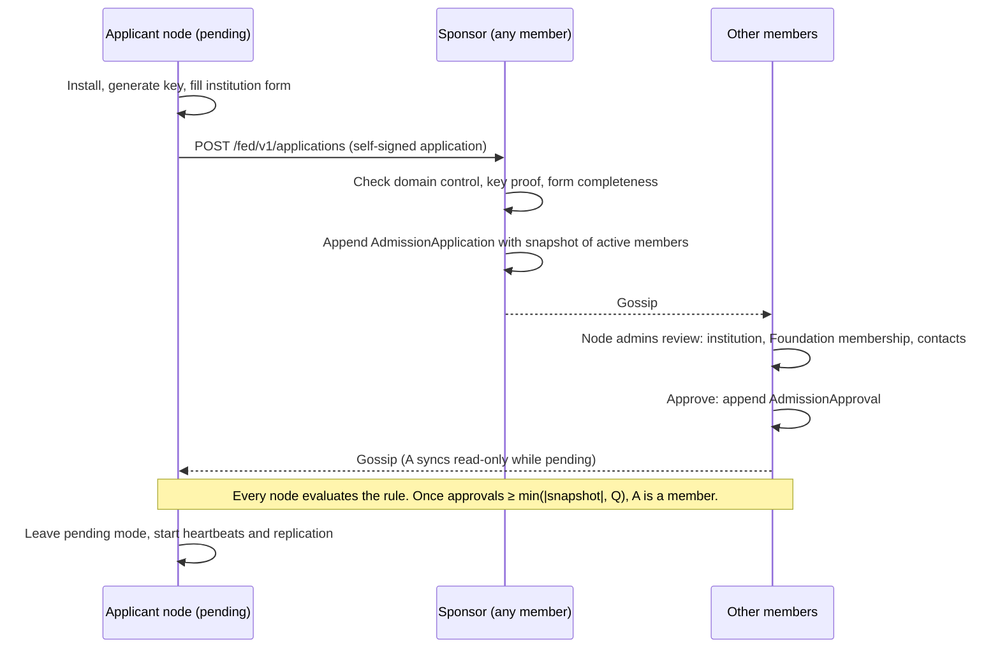

# 03 — Federation and Governance

This document specifies how nodes identify themselves, share public state without a master node, and admit new members.

## 1. Design idea

The network has no central database and no consensus protocol (no blockchain, no leader election). It relies on two properties instead:

1. **Every node publishes only statements about itself, signed with its own key**: "I approve applicant X", "I store package P", "I published DOI D". These go into the node's own append-only **feed**.
2. **All network rules are deterministic functions over those signed statements.** Membership, admissions, editorial boards and replica lists are computed locally by each node from the feeds it holds. Two nodes with the same feeds always compute the same state.

Feeds are replicated to every node by gossip, so all nodes eventually hold the same events and compute the same state. Because the admission rule only ever adds members (D-09: approvals only, no expulsion), the state only grows and never needs conflict resolution. This is what makes "no master" possible with ordinary technology.

## 2. Node identity

| Item | Specification |
|---|---|
| Node key | An Ed25519 key pair generated at installation. The private key is stored encrypted at rest; an HSM or OS keystore MAY be used. |
| Node ID | `osn:node:` followed by the base32 SHA-256 of the public key, for example `osn:node:k3f7…`. Stable for the node's lifetime, even across key rotations (the ID refers to the genesis key of that node). |
| Node code | A short, human-readable, unique code chosen at application, for example `uni-koeln`. Used in DOIs and URLs. Immutable once admitted. |
| Domain | The HTTPS base URL. It can change with a signed `NodeEndpointChanged` event. |
| Node info | `GET https://<domain>/.well-known/osn` returns the node ID, code, current public key, supported protocol versions, institution name and contact. |

A node proves control of its domain by serving the node info document at that domain, signed with its node key.

## 3. Feeds

### 3.1 Structure

Each node keeps one append-only feed. Every entry is an **event**:

```json
{
  "protocol": "osn/1",
  "feed": "osn:node:k3f7…",
  "seq": 1042,
  "prev": "sha256:9b1c…",
  "type": "AdmissionApproval",
  "created": "2027-03-02T10:15:00Z",
  "payload": { "application": "sha256:77ad…", "comment": "Verified Foundation membership." },
  "key": "ed25519:…",
  "sig": "base64…"
}
```

- `seq` increases by exactly 1 per event. `prev` is the hash of the previous event in the same feed. This makes each feed a hash chain.
- The event ID is the SHA-256 of the canonical JSON (RFC 8785) of the event without `sig`.
- `sig` is the Ed25519 signature over the same canonical bytes, made with the node key valid at `seq`.
- Events are never edited or deleted. A correction is a new event that supersedes an earlier one.

### 3.2 Synchronisation

- **Pull**: `GET /fed/v1/feeds` returns the highest `seq` the node holds for every feed it knows about. `GET /fed/v1/feeds/{nodeId}?after={seq}&limit=500` returns events.
- **Gossip**: every 60 seconds, each node pulls from 3 random active peers, and asks for every feed where the peer is ahead.
- **Push hints**: after appending an event, a node sends a small signed `POST /fed/v1/hint` to 5 random peers, so changes spread in seconds instead of minutes.
- **Relaying**: nodes serve the feeds of *other* nodes too. Since every event is signed, it doesn't matter where it comes from. Feeds therefore stay available even if their owner is offline.
- **Verification**: a receiving node MUST check the signature, the `seq` continuity and the `prev` hash before storing an event. Events from non-members are only accepted where the rules allow them (an `AdmissionApplication` relayed by a member, see §5).

### 3.3 Equivocation

If a node is found to have signed two different events with the same `seq` (a forked feed), every node that sees both MUST store both as a **fork proof**, raise an alert on the admin console, and stop accepting new events from that feed until the node's administrator resolves it with a `KeyRecovery` (§6). Forks only happen through bugs, restored backups, or a stolen key.

### 3.4 Heartbeats

Each node appends a `Heartbeat` event at least every 24 hours. Its payload includes its software version, declared storage capacity and current used storage. A member is **active** if its latest known heartbeat is less than 30 days old, and **dormant** otherwise. Dormant members stay members, but they don't count towards quorums or replica placement.

## 4. Event types

| Type | Emitted by | Purpose |
|---|---|---|
| `Genesis` | First node | Creates the network and its initial parameters. |
| `AdmissionApplication` | A member node (the sponsor) on behalf of an applicant | Carries the applicant's self-signed application. |
| `AdmissionApproval` | A member | Approves an application. |
| `AdmissionRejection` | A member | Informational objection with a reason (D-09). Doesn't affect the outcome. |
| `ApplicationWithdrawn` | The sponsor, on the applicant's request | Ends an application. |
| `Heartbeat` | Every member | Liveness and capacity. |
| `NodeEndpointChanged` | The node | New domain. |
| `KeyRotation` | The node | New key, signed with the old key. |
| `KeyRecovery` | A member, for another node | Approves a replacement key after loss or compromise (same quorum as admission). |
| `NodeRetired` | The node | Leaves the network voluntarily. |
| `FieldDefined` | Any node with a board chair of the parent field (genesis for the initial taxonomy) | Adds a field to the taxonomy. |
| `EditorAppointed` / `EditorRemoved` | The node of an approving board chair or editor | Editorial board membership (see 05 §2). |
| `ReviewerProfile` | A researcher's account node | Public reviewer-pool profile, or an update to it. |
| `ReviewerProfileWithdrawn` | Account node | Leaves the reviewer pool. |
| `PublicationPublished` | Handling node | Catalog entry for a new publication or version (see 04). |
| `PublicationStatusChanged` | Handling node, or a board chair's node in V2 | Correction, expression of concern, retraction. |
| `ReplicaAdded` / `ReplicaRemoved` | The node storing or dropping the copy | Replica list (see 04). |
| `ResolutionStewardChanged` | The new steward node | Which node keeps a DOI's resolution URL up to date (see 04 §7). |

Each payload is defined by a versioned JSON Schema published with the software.

## 5. Admission protocol

### 5.1 Parameters

Set in `Genesis`. They can be changed by vote in V2.

| Parameter | Default | Meaning |
|---|---|---|
| `admission_quorum_cap` (Q) | 10 | Maximum number of approvals ever needed. |
| `application_ttl_days` | 60 | An application expires if it isn't admitted in time. |
| `active_window_days` | 30 | Heartbeat age limit for counting as active. |
| `replication_factor` (R) | 5 | See 04. |

### 5.2 Steps



1. **Application.** The applicant fills in the form in their admin console: legal name of the institution, country, type (university or public research institute), node code, domain, technical and governance contacts, Foundation membership number, and an optional statement. The node signs it with its key. The signature proves it holds the key.
2. **Submission to a sponsor.** The applicant sends it to any member node. The sponsor's software checks that the applicant's domain serves the matching node info document, that the node code is unique and well formed, and that the fields are complete. If these checks pass, the sponsor appends `AdmissionApplication`. This is automatic and does not count as an approval. The payload contains:
   - the applicant's signed application,
   - `snapshot`: the sorted list of node IDs the sponsor considers **active members** at that moment,
   - `required = min(|snapshot|, Q)`.
3. **Review and voting.** Each member's administrators see the application in their console, with the institution details and every vote cast so far (including informational rejections and their reasons). An administrator who is satisfied clicks *Approve*. The node then appends `AdmissionApproval`.
4. **Admission.** The applicant is a **member** as soon as the network state contains valid approvals from at least `required` distinct nodes in `snapshot`. Every node evaluates this rule on its own and reaches the same result. No admission event is needed.
5. **Activation.** The new member leaves pending mode, publishes its first heartbeat, and starts taking part in replication.

### 5.3 The admission rule

An approval *v* for application *a* is **valid** if all of the following hold:

1. The node that signed *v* is in `a.snapshot`.
2. *v* was created no more than `application_ttl_days` after *a*.
3. *a* hasn't been withdrawn before *v*.
4. It's the first approval from that node for *a*. Duplicates are ignored.

Applicant *a* is a member if the number of valid approvals is at least `a.required`.

**Snapshot freshness (enforced by voting software).** A node MUST NOT approve an application whose snapshot is missing any member that the voting node knows was active before the application's creation time. Instead, the console tells the administrator to ask the sponsor to re-issue the application with a fresh snapshot. Without this rule, an applicant could reuse an old, small snapshot to get away with fewer approvals.

### 5.4 Examples

| Situation | Active members in snapshot | Approvals required |
|---|---|---|
| 2nd node applies | Node 1 | 1 (node 1) |
| 3rd node applies | Nodes 1–2 | 2 (both) |
| 6th node applies, one of the 5 members is dormant | 4 active | 4 |
| 11th node applies | 10 | 10 (all) |
| 50th node applies | 49 | Any 10 of the 49 |

This matches the intended behaviour: the first node admits the second, the first two decide on the third, and after Q members any Q approvals are enough.

### 5.5 Edge cases

| Case | Handling |
|---|---|
| Two applications at the same time | Independent. Each uses its own snapshot. If one applicant is admitted while the other is still open, the freshness rule doesn't apply to it, because it wasn't a member when the other application was created. |
| Sponsor goes offline | The application is in the sponsor's feed, which is relayed by other nodes, so voting continues. |
| Applicant changes its details | Withdraw and re-apply. Votes aren't transferred. |
| Members become dormant during voting | The required count is fixed at creation. If too many voters disappear, the application expires and is re-issued with a fresh snapshot. |
| Small networks with a dormant member | Dormant members are left out of the snapshot, so one dead node can't block admissions forever. |

## 6. Key management

- **Rotation.** A `KeyRotation` event signed with the current key announces the new key, which is valid for all later `seq`. Nodes SHOULD rotate every 2 years.
- **Loss or compromise.** The affected node's administrator installs a new key and applies for `KeyRecovery` through a sponsor, like an admission. It needs `min(|snapshot|, Q)` approvals. Once approved, events signed with the old key after a declared cut-off `seq` are treated as invalid.
- **Retirement.** `NodeRetired` removes the node from active membership for good. Its replicas are re-placed (see 04 §5).

## 7. Remedies without expulsion

Following D-09, the network can't expel a node. The remaining remedies are:

1. **Legal**: the Foundation can end a member's Foundation membership and revoke its Crossref deposit credentials. The node can then no longer register DOIs (see 04 §7).
2. **Local distrust**: each node's administrator can mark another node as *distrusted*. The local node then stops accepting that node's new catalog entries and replicas, and stops counting it for placement. Other nodes don't have to follow. Distrust decisions are published as informational events, so administrators can see each other's assessments.
3. **Transparency**: every approval is signed and public. It's always visible which nodes admitted which.

**Risk.** Once the network has more than Q members, any Q colluding members can admit further nodes, and those nodes can admit others in turn. Membership is permanent. The Foundation membership requirement is the main protection against this. Network-level suspension by vote is listed as an open question for V2 (see 10).

## 8. Shared directories

Besides membership, two directories are replicated to every node through feeds:

- **Reviewer pool.** `ReviewerProfile` events published by a researcher's account node contain the ORCID iD, display name, fields, keywords, affiliations (from ORCID), languages, an availability flag and a coarse current-load bucket (0, 1–2, 3 or more). Email addresses are **not** included. Invitations go through the signed inbox (§9) to the account node, which emails the researcher.
- **Editorial boards.** `FieldDefined`, `EditorAppointed` and `EditorRemoved` events (see 05 §2).

## 9. Signed inbox (targeted messages)

Private, targeted messages (for example "you have been invited to review manuscript X at node Y") are not gossiped. They are sent directly to the recipient's account node:

- `POST /fed/v1/inbox`, signed with an RFC 9421 HTTP Message Signature by the sending node's key.
- The body contains the recipient's ORCID iD, the message type, a link to the handling node, and minimal data. No manuscript content and no reviewer identity is sent to the author's side.
- The account node shows the item on the researcher's dashboard and sends an email. Delivery is retried with exponential backoff for up to 72 hours.

## 10. Cross-node sign-in

Every node is an ORCID client. That's why no federated session protocol is needed:

- A researcher's **account node** is where they first signed in. It owns their profile and their email address.
- To work on another node (a co-author editing a manuscript, a reviewer, an editor), the researcher follows the link and signs in there with ORCID. That node creates a **guest session** tied to the ORCID iD. It has no profile of its own: it shows the profile from the reviewer pool or account node, and grants only the roles scoped to the specific manuscript.
- Researchers can move their account to another node (V2) through a signed transfer between the two nodes.
