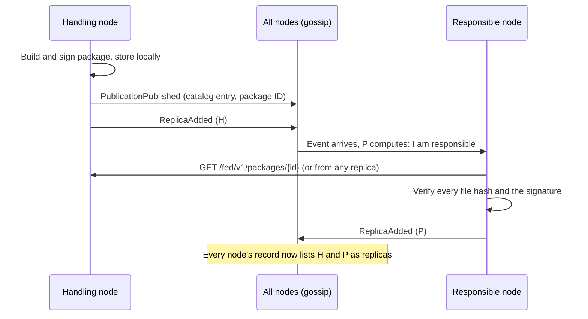

# 04 — Publications, Replication and DOI

## 1. Requirements

- R-01: Every accepted publication MUST be public, open access, and stay available as long as the network exists.
- R-02: Every publication MUST list the servers it is stored on. When a copy is added on a new server, every existing copy MUST learn about it.
- R-03: Any copy MUST be verifiable against the original, with no trust in the node it was fetched from.
- R-04: Publications MUST NOT change after publication. Corrections create new versions, and retractions add notices; nothing is deleted.
- R-05: Every publication MUST have a DOI that resolves to a live copy.

## 2. Concepts

| Concept | Description | Mutability |
|---|---|---|
| **Publication package** | All files of one published version: content in every format, sources, figures, and the complete review history up to that version. | Immutable, identified by its hash |
| **Publication record** | Per DOI: list of versions, current status, replica list. | Derived from feed events on every node |
| **Catalog entry** | Metadata, abstract and plain full text for search. Part of `PublicationPublished`. | Replicated to every node |

The replica list is part of the *record*, not of the *package*. That's what lets copies stay immutable while "all existing copies get updated" (R-02): adding a copy changes the record on every node, and no package file has to be rewritten.

## 3. Package format

A package is a directory, distributable as a tar archive:

```
manifest.json              Metadata, file list with hashes, signatures
content/
  article.sdm.json         Canonical document (Scholarly Document Model, see 06)
  article.html             Rendered web version (MathML)
  article.pdf              Rendered PDF
  article.jats.xml         JATS 1.3 XML
  source/                  Authoring source (rich-text JSON or LaTeX subset)
  assets/                  Figures, in original and web-optimised form
  supplementary/           Supplementary files
history/
  versions/v1/…            Every submitted version (SDM + PDF) and the diffs between versions
  rounds/1/reviews/*.json  Review reports with their points, recommendation and signed-review flag
  rounds/1/responses.json  The author's point-by-point responses
  rounds/1/decision.json   Decision letter
  timeline.json            All workflow events with dates (submitted, editor assigned, invitations sent/accepted …)
  ai-feedback.json         AI suggestions and reviewer verdicts with explanations (empty in V1)
```

### 3.1 Manifest

```json
{
  "osn_package": "1.0",
  "doi": "10.XXXXX/osn.uni-koeln.2027.00042",
  "version": 1,
  "previous_version_package": null,
  "publication_type": "research-article",
  "language": "en",
  "title": { "en": "…" },
  "abstract": { "en": "…" },
  "keywords": { "en": ["…"] },
  "topics": {
    "taxonomy": "openalex-topics@2026-06",
    "primary": "T11636",
    "additional": ["T10028", "T12262"],
    "extensions": []
  },
  "responsible_board": "osn:board:…",
  "related": [ { "relation": "is-commentary-on", "doi": "…" } ],
  "license": "CC-BY-4.0",
  "authors": [
    { "name": "Zhang Wei", "name_native": { "zh-Hans": "张伟" }, "orcid": "0000-0002-…", "affiliations": ["…"], "corresponding": true, "contributor_roles": ["Conceptualization", "Writing – original draft"] }
  ],
  "editor": { "name": "…", "orcid": "…" },
  "co_editors": [ { "name": "…", "orcid": "…", "board": "osn:board:…" } ],
  "reviewers": [ { "name": "…", "orcid": "…", "rounds": [1, 2] } ],
  "dates": { "submitted": "…", "accepted": "…", "published": "…" },
  "funding": [], "data_availability": "…", "competing_interests": "…",
  "references": [ { "doi": "…", "csl": { } } ],
  "renderer": "osn-render 1.4.2",
  "handling_node": "osn:node:k3f7…",
  "files": [ { "path": "content/article.pdf", "sha256": "…", "bytes": 482113, "media_type": "application/pdf" } ],
  "package_id": "sha256:…",
  "signatures": [ { "node": "osn:node:k3f7…", "key": "ed25519:…", "sig": "…" } ]
}
```

- `package_id` is the SHA-256 over the canonical manifest without `package_id` and `signatures`. The manifest contains every file's hash, so the package ID covers all content.
- The handling node signs the package. The signature confirms that the editorial decision recorded in `history/` took place on that node.
- Contributor roles follow the CRediT taxonomy.
- `title`, `abstract` and `keywords` are maps from language tag to text. English is always present (11 §5.1). `related` links commentaries, replies, notices, datasets and software to their targets (12 §6).

## 4. Publication record

Every node computes each publication's record from the feeds:

| Field | Source |
|---|---|
| `doi`, `handling_node` | First `PublicationPublished` for the DOI |
| `versions[]` (package ID, version number, date) | All `PublicationPublished` events for the DOI from the handling node |
| `status` (`published`, `corrected`, `expression_of_concern`, `retracted`) | Latest `PublicationStatusChanged` |
| `replicas[]` | Nodes with a `ReplicaAdded` for the package and no later `ReplicaRemoved`, filtered to verified (§6) and non-distrusted nodes |
A node only makes statements about itself (`ReplicaAdded` means "I hold a copy"). So there are no conflicting writes, and every node converges on the same replica list.

## 5. Placement

### 5.1 Which nodes store a package

- Target number of copies: `r = min(R, number of active, trusted members)`.
- Placement uses **weighted rendezvous hashing** (highest random weight). For each active member *n*: `score(n) = −weight(n) / ln(hash(package_id ‖ n.node_id) as a value in (0,1))`, where `weight(n)` is the node's declared capacity share. The *r* highest-scoring nodes are the **responsible nodes**.
- Every node can compute the responsible set by itself, with no coordination. When membership changes, only about 1/N of all packages move.
- The handling node always keeps a copy in addition to the responsible set (its package is the origin of the first replication).
- **Voluntary mirrors**: an administrator can configure a node to mirror *all* packages, or packages in selected parts of the taxonomy (for example one domain or field). Mirrors announce themselves with `ReplicaAdded` like everyone else.

### 5.2 Replication flow



1. When a node learns about a package it is responsible for, it fetches the package from any node in the current replica list. Downloads are resumable and file-level, so a partial copy can be completed from several sources.
2. It verifies every file hash, the manifest hash and the handling node's signature.
3. Only after verification does it append `ReplicaAdded`.

## 6. Audit and repair

- **Storage challenges.** Every 24 hours each node picks a random sample of replicas held by other nodes. It sends a challenge: "return SHA-256(nonce ‖ bytes [x, y) of file f of package p)". The challenger can compute the answer itself if it holds a copy. Otherwise it verifies against a later fetch.
- **Failure handling.** A node that fails challenges or is unreachable for 7 days is treated as *unverified* for that package, and isn't counted in `r` for repair purposes (it stays in the list, shown as unverified).
- **Repair.** If a package has fewer than `r` verified replicas, the next-ranked nodes in the placement order fetch a copy. Ranking is deterministic, so nodes don't need to coordinate. Nodes check their responsibilities after every membership or heartbeat change and once a day.
- **Re-placement.** If membership changes and a node is no longer responsible, it MAY keep its copy (more copies are fine). It MAY drop it after the new responsible nodes have verified copies, and then appends `ReplicaRemoved`.

## 7. DOI registration

### 7.1 Model

- The **Open Science Foundation** is a Crossref member and owns the DOI prefix `10.XXXXX` (A-01, D-08).
- The Foundation issues **per-node Crossref deposit credentials** when a node joins (Crossref supports multiple credentials per member account). Each node deposits its own DOIs directly, so no node is in the critical path for another node's publications. The Foundation can revoke a node's credentials (03 §7).
- Suffix format: `osn.{node_code}.{year}.{sequence}`, for example `10.XXXXX/osn.uni-koeln.2027.00042`. The node code is unique network-wide and the sequence is per node, so suffixes never collide without any coordination.
- DOIs are registered when production is complete (see 05 §9) and **before** `PublicationPublished`. The DOI is part of the package.

### 7.2 Deposit content

- Article metadata generated from the manifest: titles, contributors with ORCID iDs, affiliations (with ROR IDs where known), publication dates, licence, funding, the full reference list (enables Crossref Cited-by), the abstract, and relations between versions.
- [V2] Each review report and author response is registered as a Crossref `peer_review` item with its own DOI, linked to the article. Reviewers get citable credit for their work.

### 7.3 Resolution

- Every DOI resolves to the **front door**: `https://<network-domain>/p/{doi}` (02 §6). Any healthy front-door node serves the landing page. Nodes without a local replica fetch the package from a replica and cache it.
- The resolution URL never has to change when a node fails or retires. A DOI only depends on the front door being reachable, and at least 3 front-door nodes back it.
- `https://{any-node}/p/{doi}` also works on every node, for direct links.
- [V2] Crossref multiple resolution MAY additionally list individual replica URLs.

## 8. Reading, indexing and archiving

| Requirement | Specification |
|---|---|
| Landing page | Title, authors, abstract, licence, DOI, version selector, status banner (correction, retraction), HTML full text, PDF/JATS/source download, citation export (BibTeX, RIS, CSL-JSON), and a "Peer review history" tab with every round. |
| Replica transparency | The landing page lists the nodes holding copies and when each was last verified. |
| Caching | Package files are immutable, so they're served with `Cache-Control: immutable` and can be cached by any CDN. |
| Google Scholar | Highwire `citation_*` meta tags. Every node publishes a sitemap of the publications it stores. |
| OAI-PMH | `/oai` on every node exposes the whole catalog (Dublin Core and JATS), for OpenAIRE, BASE and library aggregators. |
| ORCID | [V2] With ORCID membership, publications are written to the authors' ORCID records automatically. |
| External archives | The Foundation SHOULD sign a contract with a preservation service (Portico or CLOCKSS) or a national library. A designated node delivers packages there automatically. |
| Indexing | DOAJ, Scopus and Web of Science have editorial criteria (ISSN, editorial board, policies, publication history) that the Foundation must meet. This is an organisational task with technical support from the metadata above. |

## 9. Sizing

Estimates for planning, assuming an average package of 10 MB (including figures and history) and 50 KB of catalog text per publication:

| Publications | Catalog per node | Total package data | Per node with R = 5, 50 nodes | Per node with R = 5, 200 nodes |
|---|---|---|---|---|
| 100k | 5 GB | 1 TB | 100 GB | 25 GB |
| 1M | 50 GB | 10 TB | 1 TB | 250 GB |

Nodes that declare more capacity receive proportionally more replicas (§5.1).

## 10. Corrections, retractions and legal removal

- **Correction**: authors propose it, and the handling editor (or the board chair, if the editor isn't available) approves it. A new package with `version` + 1 and a correction note is published. Earlier versions remain available.
- **Retraction / expression of concern**: decided by a chair of the responsible board, following COPE guidelines. The notice is published as its own editorial notice with a DOI (12 §6.3), and the handling node appends `PublicationStatusChanged` referring to it. Content stays available with a prominent banner. [V2] If the handling node no longer exists, the board chair's node can issue the status change.
- **Legal removal** (for example a court order in one jurisdiction): a node MAY stop serving a package locally and append `ReplicaRemoved` with reason `legal`. The network-wide record keeps the metadata and a notice. The Foundation coordinates cases that affect every node.
