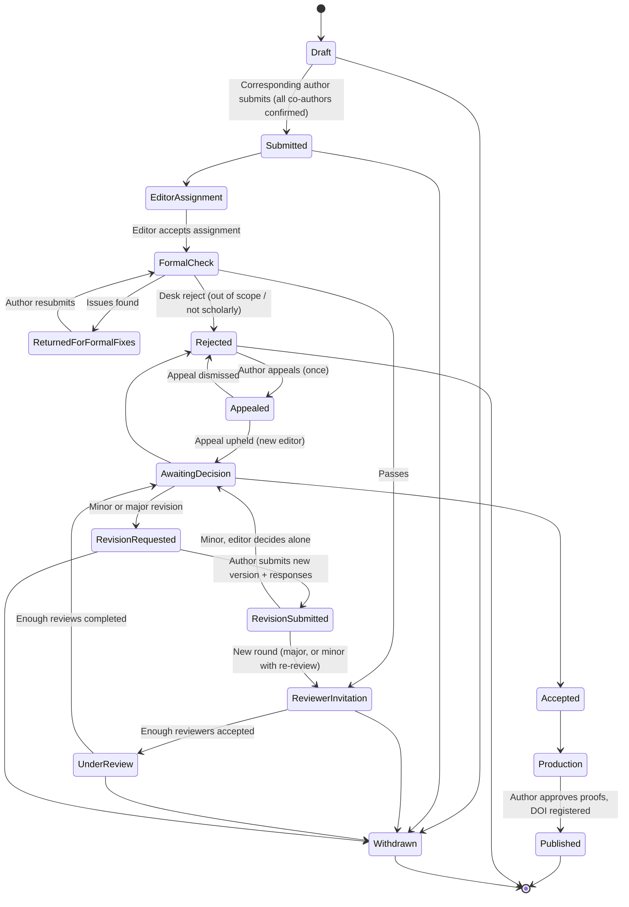

# 05 — Editorial Workflow

The workflow follows the usual journal process, with three differences: editors come from network-wide boards, AI assistance plugs in at defined points, and the full history of accepted papers is published.

## 1. Where the workflow runs

All workflow data for a manuscript lives on its **handling node**, which is the node where the corresponding author created it. Editors, reviewers and co-authors from other nodes sign in there with ORCID (03 §10). Notifications reach them through their account nodes (03 §9).

## 2. Fields and editorial boards

### 2.1 Taxonomy

- The initial taxonomy is the OECD FORD classification, two levels (for example *1 Natural sciences*, then *1.2 Computer and information sciences*) (A-05). It is defined by `FieldDefined` events in the genesis node's feed.
- A board chair of a field can add sub-fields (`FieldDefined` with a parent).
- A manuscript has one primary field (which decides the board) and up to three secondary fields (used for reviewer matching).

### 2.2 Board roles

| Role | Appointed by | Responsibilities |
|---|---|---|
| Board chair (1–3 per field) | Bootstrap: the Foundation's designated chairs. Later: the other chairs of the field, or the chairs of the parent field. | Appoint and remove editors, handle appeals and integrity cases, reassign manuscripts, set board policies (minimum reviews, citation style, deadlines). |
| Editor | A board chair, or 2 existing editors of the field | Handle manuscripts. |

- Researchers can apply to become editors of a field. The application shows their ORCID record and publications to the chairs.
- Appointment and removal are `EditorAppointed` / `EditorRemoved` events in the feed of the approver's account node. Each event names the approving chair or editors. Every node checks the event: the approvers must have held the required role at the time, according to earlier events.
- Board membership, policies and editor load are public.

## 3. Manuscript states

Every transition is recorded in the manuscript's timeline with actor, time and reason. After publication the timeline becomes part of the package (`history/timeline.json`), with reviewer identities revealed (D-04).

## 4. Submission

Before a manuscript can be submitted, the system checks that:

- every co-author has confirmed their authorship and contributor roles (by signing in with ORCID and confirming);
- required metadata is complete: title, English abstract and keywords (A-07), fields, licence (A-02), funding, competing interests, data availability statement and ethics statement where applicable;
- the document passes **structural validation**: required sections, every figure and table has a caption and alt text, every citation resolves to a reference, cross-references resolve, and the renderer produces HTML and PDF without errors;
- the author has accepted the transparency terms, which state that the review history will be published if the paper is accepted.

On submission, the current document is frozen as **version 1**. The authors can keep editing a working copy, but the editor and reviewers only see frozen versions.

## 5. Editor assignment

1. The system proposes an editor from the board of the primary field:
   - excluding conflicts (§7);
   - ranked by keyword overlap with the manuscript, then by lowest current load, then randomly.
2. The proposed editor receives an inbox invitation with title, abstract and fields. The editor accepts within 3 days, or declines with a reason.
3. If they decline or don't answer in time, the next candidate is asked. After 3 failed attempts, the board chairs are notified and assign someone manually.
4. Board chairs can reassign a manuscript at any time, with a recorded reason.

[V2] The AI editor proposes the editor and the reviewers. The editor remains a human who confirms.

## 6. Formal check

The handling editor works through a checklist. In V2 the AI formal check pre-fills it with findings.

| Check | Example findings |
|---|---|
| Scope | Fits the field, is scholarly work. |
| Structure | Required sections present for the article type. Abstract within the word limit. |
| Language | Readable enough for review. |
| References | Plausible, resolvable DOIs, no obvious citation manipulation. |
| Figures and tables | Legible, captioned, alt text present, licensed. |
| Declarations | Ethics approval, consent, funding, competing interests, data availability. |
| Integrity | [V2] Similarity check, image manipulation screening. |

Possible outcomes are *passes*, *returned for formal fixes* (with a list of findings, and the author resubmits without starting a new review round) or *desk rejection* (with a written reason). The formal check result is part of the public history for accepted papers.

## 7. Conflicts of interest

A person may not act as editor or reviewer for a manuscript if they:

- are an author;
- share a current affiliation with any author (from ORCID affiliations and the manuscript's metadata);
- co-authored a publication with any author in the last 5 years (from ORCID works and Crossref, where available);
- declare a conflict themselves (the invitation always asks).

Detected conflicts block the invitation. Self-declared conflicts lead to an automatic decline. The editor sees the reason for every excluded candidate.

## 8. Reviewers

### 8.1 Pool and eligibility

- Researchers opt in to the pool on their profile, choosing fields, keywords, languages and availability (`ReviewerProfile`).
- Because identity is ORCID only (D-05), each board sets an **eligibility rule**. The default: the ORCID record lists at least one work with a DOI whose source is a trusted organisation (for example Crossref auto-update), and the ORCID account is older than 6 months. The editor can override the rule for a specific invitation, with a reason.
- The editor sees eligibility signals for each candidate: account age, works, verified affiliations, past reviews in the network, and any open reports.
- Author-suggested reviewers are allowed and are marked as such. At least one reviewer per round MUST NOT be author-suggested.

### 8.2 Invitation

1. The editor searches the pool. A recommendation list is shown, ranked by field and keyword overlap, reviewing history and current load (`ReviewerRecommender`). This is a simple non-AI algorithm in V1 and AI-based in V2.
2. The editor invites at least as many reviewers as the board's minimum (default 2, A-06), typically 3.
3. The invitation shows the title, abstract, fields, deadline (default 21 days) and the transparency terms. It explains that the reviewer's name and report will be published if the paper is accepted.
4. The reviewer **accepts** or **declines**. A decline asks for a reason (no time, out of expertise, conflict, other) and optionally suggests an alternative reviewer.
5. Without an answer within 5 days, the invitation expires and the editor is notified.
6. Reminders go out 7 days and 2 days before the deadline. Reviewers can ask for an extension, which the editor approves or rejects.

### 8.3 Review form

| Section | Content | Visible to author | Public after acceptance |
|---|---|---|---|
| Summary | The reviewer's summary of the paper and its contribution | Yes | Yes |
| Points | Numbered points, each with a category (major, minor, typo/language), a text, and optionally an anchor to a location in the manuscript | Yes | Yes |
| AI suggestions | Suggestions from `ReviewAssistant` with the reviewer's verdict and explanation (§8.4) | Accepted ones appear as points | Yes, all with verdicts |
| Recommendation | Accept, minor revision, major revision, reject | Yes | Yes |
| Confidential comments | Ethics and conflict concerns for the editor only (A-10) | No | No |

The reviewer reads the frozen version in an HTML viewer, with the PDF available, and can place points directly on passages of the text.

### 8.4 AI review assistant

- Interface: `ReviewAssistant.suggest(manuscriptVersion, field, reviewerContext) → Suggestion[]`. A suggestion has an anchor, a category, a text, a rationale and a model version.
- **V1: the stub returns an empty list.** The UI panel exists and shows "No suggestions", so V2 needs no UI change.
- For each suggestion the reviewer MUST choose **accept** or **reject**, and MUST write a short explanation (at least 10 characters). Accepted suggestions become review points, which the reviewer can edit.
- The verdict and explanation are stored as `SuggestionFeedback` and used as training data in V2. For accepted papers, the feedback is published with the review history. For rejected papers, it stays private and is used for training only if the reviewer consented.

## 9. Decisions

1. When the minimum number of reviews is complete, the manuscript moves to *awaiting decision*. The editor can also wait for further reviews.
2. The editor chooses **accept**, **minor revision**, **major revision** or **reject**, and writes a decision letter. The letter is prefilled with all reviews.
3. If the decision goes against the majority of reviewer recommendations, the editor MUST write a justification. It is part of the public record.
4. The author receives the decision letter and all reviews, without reviewer names (D-04).

## 10. Revisions

1. The author edits the working copy, then submits it as a new frozen version (v2, v3 …). The deadline is 30 days for minor and 90 days for major revisions; authors can request an extension.
2. The author MUST respond to **every** review point: *addressed* (with an explanation and links to changed passages), *partially addressed*, or *not addressed* (with a reason). They can add a general response letter.
3. The system generates a **diff** between the versions, shown to editor and reviewers.
4. After a **major revision**, a new round starts. The same reviewers are invited again by default, and the editor can add new ones.
5. After a **minor revision**, the editor decides alone, or opens a new round.
6. A board can set a maximum number of rounds (default 4). After that, the editor must accept or reject.

## 11. Appeal

An author can appeal a rejection **once**, within 30 days, with a written statement (A-12). The board chair either dismisses the appeal with a reason, or upholds it and assigns a new editor, who starts from *awaiting decision*.

## 12. Production and publication

1. **Accepted** puts the manuscript into *production*. The final version is rendered to HTML, PDF and JATS with the house style.
2. The corresponding author reviews the **proofs**. Only corrections of typos and errors are allowed; content changes need the editor's approval. Co-authors are notified.
3. Once the author approves, the handling node:
   1. reserves the DOI suffix;
   2. builds the package (04 §3), including the complete history with reviewer names revealed and signed reports;
   3. registers the DOI with Crossref (04 §7);
   4. stores and signs the package, and appends `PublicationPublished` and `ReplicaAdded`;
   5. notifies authors, editor and reviewers.
4. The publication is immediately readable on the handling node and, within minutes, findable through every node's catalog. Replication to R nodes follows automatically.

## 13. What becomes public

| Item | Accepted papers | Rejected papers (default) | Rejected papers (author opted in) |
|---|---|---|---|
| All submitted versions and diffs | Yes | No | Yes |
| Formal check result | Yes | No | Yes |
| Review reports, points, recommendations | Yes | No | Yes |
| Reviewer names | Yes | No | Yes (reviewers were told at invitation) |
| AI suggestions and verdicts | Yes | No | Yes |
| Author responses | Yes | No | Yes |
| Decision letters, justifications | Yes | No | Yes |
| Editor name | Yes | No | Yes |
| Timeline (dates of all steps) | Yes | No | Yes |
| Declined invitations | Only counts | No | Only counts |
| Confidential comments | Never | Never | Never |

A rejected paper whose author opts in is published as a **rejected record**: it has a landing page and the full history, gets no article DOI, and is clearly labelled as not accepted. It is replicated like a publication. *Whether rejected records should get a DOI is an open question (see 10).*

**Withdrawn** manuscripts are never public. Unpublished data is deleted according to the retention policy (09 §5).

## 14. Deadlines and defaults

| Step | Default | Configurable by |
|---|---|---|
| Editor accepts assignment | 3 days | Board |
| Formal check | 7 days | Board |
| Reviewer answers invitation | 5 days | Board |
| Review completed | 21 days | Board, extendable by the editor |
| Editor decision after reviews | 7 days | Board |
| Minor / major revision | 30 / 90 days | Board, extendable by the editor |
| Appeal | 30 days | Network policy |
| Maximum rounds | 4 | Board |

Overdue steps escalate: first to the actor, then to the editor, then to the board chairs.

## 15. Notifications

Notifications go through the in-app dashboard and email. Researchers choose immediate or daily-digest emails for non-urgent items. Notifications that carry deadlines (invitations, decisions, revision requests) are always sent immediately.
