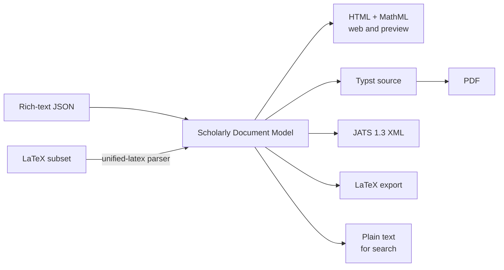

# 06 — Authoring and Document Model

## 1. Goals

- Researchers from **every field** can write their paper in the portal. That includes mathematics (formulas, theorems, proofs), computer science (code listings, algorithms), natural sciences (figures, tables, units, chemistry), humanities (footnotes, long quotations) and the social sciences.
- Two writing modes: a **rich-text editor** (Word-like) and a **LaTeX editor** (Overleaf-like, restricted subset, D-10).
- **Every paper has the same clean layout.** Authors control structure and content, not layout.
- What the author sees in the preview is exactly what will be published.
- Co-authors can write together in real time.

## 2. Scholarly Document Model (SDM)

The SDM is the canonical, structured representation of a paper. Both editors read and write it, all renderers consume it, and it is stored in every package.

### 2.1 Structure

The SDM is a typed JSON tree, compatible with the ProseMirror document format. Its schema is versioned (`sdm_version`). Every node has a stable `id`, so review points can anchor to passages and the anchors survive revisions.

| Category | Node types |
|---|---|
| Front matter | `title`, `subtitle`, `abstract`, `keywords`. Authors and affiliations come from manuscript metadata, not from the document body. |
| Structure | `section` (levels 1–4, numbered), `appendix`, `acknowledgements` |
| Blocks | `paragraph`, `blockquote`, `bullet_list`, `ordered_list`, `list_item`, `code_block` (language), `horizontal_rule` |
| Math | `math_inline`, `math_display` (LaTeX source, optional label, numbered), `math_align` (multi-line, numbered lines) |
| Theorem-like | `theorem`, `lemma`, `proposition`, `corollary`, `definition`, `example`, `remark`, `proof`. Numbered; extendable per board. |
| Figures | `figure` (one or more `image` nodes or subfigures, `caption`, `alt_text`, label) |
| Tables | `table` (header rows, merged cells, alignment, `caption`, label, optional notes) |
| Algorithms | `algorithm` (pseudocode with line numbers, caption, label) |
| References | `citation` (one or more reference keys, optional locator), `cross_reference` (target label, auto-formatted "Figure 3", "Eq. (2)"), `footnote` |
| Inline marks | `emphasis`, `strong`, `code`, `subscript`, `superscript`, `small_caps`, `link`, `language` (BCP 47 tag, and direction for text in another language or script, 11 §2) |
| Special | `chemical_formula` (mhchem syntax), `quantity` (number with SI unit) |

Not in the model: fonts, colours, font sizes, spacing, page geometry, manual line or page breaks, and arbitrary HTML. Those are decided by the house style.

**Languages.** The document root carries the paper's language (`lang`). Any block can override it (for example a quotation in Arabic), and so can the `language` mark inline (for example a Chinese name). All text is Unicode, normalised to NFC (11 §4).

**Publication types.** Each publication type (12 §6) comes with a **section template**: the suggested and required sections that are pre-created when a manuscript is started (for example *Dataset description* and *Data access* for data papers). Required sections are checked when the paper is submitted. Authors can rename and add sections, but can't remove required ones.

### 2.2 Bibliography

- References are stored separately from the text, as **CSL-JSON** with a key per reference.
- Ways to add a reference: enter a DOI (metadata fetched from Crossref), an ISBN, or an arXiv ID; paste BibTeX; import a `.bib` or `.ris` file; or enter it manually.
- The citation style is the board's house style (A-11), rendered with citeproc. Authors don't choose styles.

## 3. Rich-text editor

- Built with Tiptap/ProseMirror, using the SDM schema. It can only produce valid documents.
- **Math input**: type `$…$` or `\[…\]` for LaTeX with live rendering (KaTeX), or open a **visual math editor** (MathLive) for people who don't know LaTeX. In both cases the stored form is LaTeX.
- Toolbar and slash commands for every block type (figure, table, theorem, algorithm, citation, cross-reference …).
- Paste from Word or web pages is cleaned into SDM. Unsupported formatting is dropped, and a notice shows what was removed.
- A side panel shows the outline, the references, and validation problems (for example a missing alt text or a broken cross-reference).

## 4. LaTeX editor

- Built with CodeMirror 6: syntax highlighting, autocompletion for supported commands, labels and citation keys, and live error markers.
- The source is parsed (unified-latex) and converted to SDM on every change. The preview pane is rendered from that SDM by the same renderer used for publication.
- Bibliography: `\cite{key}` refers to keys in the manuscript's reference list, which can be managed by uploading a `.bib` file.

### 4.1 Supported subset

| Area | Supported |
|---|---|
| Sectioning | `\section`, `\subsection`, `\subsubsection`, `\paragraph`, `\appendix` |
| Text | `\emph`, `\textbf`, `\textit`, `\texttt`, `\textsc`, `\textsuperscript`, `\textsubscript`, `\footnote`, `\url`, `\href`, quotes, dashes, common accents and special characters, direct Unicode input in any script |
| Languages | `\foreignlanguage{lang}{…}`, the `otherlanguage` environment (mapped to SDM language marks, 11 §6) |
| Lists | `itemize`, `enumerate`, `description` |
| Math | `$…$`, `\(…\)`, `\[…\]`, `equation`, `equation*`, `align`, `align*`, `gather`, `multline`, `cases`, matrices. The amsmath and amssymb macros as supported by KaTeX/Temml. `\mathbb`, `\mathcal`, `\operatorname`, and similar. |
| Math macros | `\newcommand` and `\DeclareMathOperator` **for math only**, expanded at parse time |
| Theorems | `theorem`, `lemma`, `proposition`, `corollary`, `definition`, `example`, `remark`, `proof` (predefined; `\newtheorem` maps onto these or onto a board-defined list) |
| Figures | `figure` with `\includegraphics` (uploaded files only), `\caption`, `\label`, `subfigure` |
| Tables | `table` and `tabular` with `l c r p{}`, `\multicolumn`, `\multirow`, booktabs rules |
| Code | `verbatim`, `lstlisting` and `minted` (language option only), `algorithm` / `algorithmic` |
| References | `\cite`, `\citep`, `\citet`, `\ref`, `\eqref`, `\autoref`, `\cref` |
| Chemistry and units | `\ce{}` (mhchem), `\SI{}{}`, `\si{}`, `\num{}` (siunitx core) |

### 4.2 Not supported

Rejected with a clear error message and the suggested alternative:

- Arbitrary `\usepackage`. The packages above are implied, and anything else is an error.
- `\input`, `\include`, `\write18` and all file or shell access. LaTeX source is **parsed, never executed**, so it carries no code-execution risk.
- Layout commands: `geometry`, `\vspace`, `\hspace` (outside math), fonts, colours, `\newpage`, page styles, custom `\def` outside math.
- TikZ and PGFPlots. Authors upload the figure as SVG or PDF instead. [V3] Server-side compilation of TikZ figures to SVG in a sandbox is an option.

### 4.3 Switching modes

A manuscript has one authoring mode. Its source of truth is that editor's format (ProseMirror JSON or LaTeX text), so LaTeX formatting and comments are preserved. Authors can convert to the other mode at any time; the conversion is explicit and shows a preview:

- Rich text → LaTeX: lossless (every SDM node has a LaTeX form).
- LaTeX → rich text: lossless for content. LaTeX comments, the author's own formatting of the source, and math macro definitions are lost (macros are expanded).

## 5. Collaboration

- Real-time co-editing with Yjs, in both modes: cursors and presence of co-authors, offline editing with later merge.
- **Comments** anchored to text, with threads and resolution.
- **Snapshots**: automatic hourly snapshots, plus named snapshots on demand. Any snapshot can be compared with or restored to the current text.
- **Permissions** per manuscript: corresponding author (all rights, can transfer the role), co-author (edit and comment), viewer (read and comment, for example a supervisor).
- [V2] Track changes (suggestion mode).

## 6. Figures and files

| Type | Accepted | Processing |
|---|---|---|
| Raster images | PNG, JPEG, TIFF, max 50 MB | Converted to web formats (WebP/AVIF plus PNG fallback). The original is kept. |
| Vector graphics | SVG, PDF, EPS | SVG sanitised (scripts removed). PDF/EPS converted to SVG for the web and kept as vector for the PDF. |
| Supplementary | Any type, max 200 MB per file, 1 GB per manuscript | Malware scan. Large datasets SHOULD go to a data repository (for example Zenodo) and be cited by DOI. |

Alt text is required for every figure (accessibility, NFR-09). Authors must confirm that they have the right to publish each figure under the article licence.

## 7. Rendering pipeline

- **HTML**: math rendered to MathML (Temml) on the server, no client-side JavaScript needed for reading. Responsive house style.
- **PDF**: SDM is converted to Typst markup with the house template, and LaTeX math to Typst math. Output: A4 PDF, embedded fonts, PDF/A where possible, tagged for accessibility where the engine supports it.
- **JATS**: for archives and indexers (PubMed Central, Crossref, preservation services).
- Renderers are **deterministic and versioned**. The renderer version goes into the manifest, so the published PDF can be reproduced from the package.
- **Phase-0 spike** (see 10): render a set of difficult test documents (dense math, large tables, many figures, footnotes, and the multilingual test corpus of 11 §10 with right-to-left, CJK and Indic text) through Typst and through HTML-to-PDF, and compare quality and performance before choosing.

## 8. House style

- One layout for the whole journal: one template for the web and one for the PDF, with typography, numbering and running headers.
- Per-board variations are limited to the citation style (numeric or author–year, A-11) and the list of theorem-like environments.
- Generated labels ("Abstract", "Figure", "References" …) and citation formatting follow the **paper's language**, not the reader's UI language (11 §5.2). The publication type is shown in the header ("Research article", "Data paper" …). Editorial notices carry a visible "Not peer reviewed" label (12 §6.3).
- The style is versioned and governed by the Foundation's editorial council (an organisational question).

## 9. Import [V2]

| Source | Method | Result |
|---|---|---|
| DOCX | Pandoc to an intermediate AST, then SDM. Equations (OMML) converted to LaTeX. Embedded images extracted. Word citations (Zotero/Mendeley fields) converted to CSL-JSON where possible. | An SDM draft plus an **import report** listing everything that couldn't be converted, with links to the affected places. |
| LaTeX project (zip) | Main file detected; `\input` files merged *at import time only*; parsed with the same subset rules; `.bib` imported. | A LaTeX-mode draft plus an import report listing unsupported commands, each with a suggested replacement. |

Imports always create a draft for the author to fix. They never submit directly.
