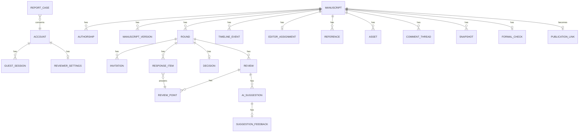

# 08 — Data Model and APIs

This document gives the logical data model and the API surface. Physical schemas (column types, indexes) are left to implementation.

## 1. Transactional data (PostgreSQL, per node)



| Entity | Key attributes |
|---|---|
| `account` | ORCID iD (unique), display name, native-script name (optional, with language tag), verified email, UI language, notification settings, created, status (active, suspended) |
| `guest_session` | ORCID iD, account node ID, expiry. Used for researchers from other nodes. |
| `reviewer_settings` | Enabled, capacity per quarter, paused until, topics, keywords, languages (published as `ReviewerProfile`) |
| `manuscript` | ID, publication type (and subtype), authoring mode, language (BCP 47), taxonomy version, primary topic, additional topics, sub-topics, responsible board, related DOIs (commentary target, dataset, software), state, corresponding author, working document (Yjs state plus SDM), metadata (title, abstract and keywords as language-tagged maps, funding, declarations, type-specific declarations, licence), created |
| `authorship` | Manuscript, ORCID iD, order, native-script name, affiliations (with ROR IDs), CRediT roles, confirmed at |
| `co_editor_assignment` | Manuscript, co-editor ORCID iD, board, invited, accepted or declined, recommendation per round, disagreement note |
| `manuscript_version` | Manuscript, version number, frozen SDM, source, rendered HTML/PDF, content hash, submitted at |
| `reference` | Manuscript, key, CSL-JSON, DOI |
| `asset` | Manuscript, file path in the store, hash, media type, alt text, rights confirmed |
| `editor_assignment` | Manuscript, editor ORCID iD, proposed at, accepted at, declined (reason), reassigned (reason) |
| `formal_check` | Manuscript version, checklist results, findings, outcome, AI findings (V2) |
| `round` | Manuscript, number, version, opened, closed |
| `invitation` | Round, reviewer ORCID iD, author-suggested flag, sent, response, decline reason, suggested alternative, deadline, extensions |
| `review` | Round, reviewer ORCID iD, language, summary, answers to type-specific questions, recommendation, confidential comment, submitted at |
| `review_point` | Review, number, category, text, anchor (SDM node ID plus text range), origin (reviewer, AI suggestion) |
| `ai_suggestion` | Review, model version, anchor, category, text, rationale |
| `suggestion_feedback` | Suggestion, verdict (accept or reject), explanation, training consent |
| `response_item` | Round, review point, status (addressed, partially, not addressed), explanation, links to changed passages |
| `decision` | Round, editor, outcome, letter, justification against the majority |
| `timeline_event` | Manuscript, time, actor ORCID iD, event type, data. Append-only. |
| `publication_link` | Manuscript, DOI, package IDs per version |
| `report_case` | Reporter, reported ORCID iD, category, description, evidence, status, outcome, handlers |
| `notification` | Recipient, type, links, read, email sent |
| `audit_log` | Every privileged action: actor, action, object, time, IP. Append-only. |

## 2. Network state (derived from feeds, on every node)

| Table | Derived from |
|---|---|
| `feed_event` | All verified events, raw (ID, feed, seq, type, payload, signature) |
| `node` | `Genesis`, admission rule, `Heartbeat`, `KeyRotation`, `KeyRecovery`, `NodeEndpointChanged`, `NodeRetired`. Columns: node ID, code, domain, keys, institution, member since, active or dormant, capacity, local trust status |
| `application` | `AdmissionApplication`, approvals, rejections, withdrawals, computed status |
| `board` | `BoardDefined`, `BoardScopeChanged`: board ID, name (per language), subfields covered, policies, enabled publication types |
| `topic_extension` | `TopicExtensionDefined`: ID (`osn:` prefix), parent OpenAlex topic, labels per language |
| `board_role` | `EditorAppointed` / `EditorRemoved`, with validity periods |
| `reviewer_directory` | `ReviewerProfile` / `ReviewerProfileWithdrawn`, plus pool-suspension outcomes from UC-U4 |
| `catalog` | `PublicationPublished`: DOI, versions, metadata, abstract, plain text, `tsvector` for search |
| `publication_status` | `PublicationStatusChanged` |
| `replica` | `ReplicaAdded` / `ReplicaRemoved`, plus local audit results |
| `account_directory` | `AccountRegistered`, `AccountClosed`, `AccountMoved`: ORCID iD, account node, registered at |
| `partner` | `PartnerAgreement`, `PartnerAgreementEnded`, `PartnerCopyStatus`: source node, partner node, since, last copy, integrity status |

These tables are caches. They can be rebuilt by replaying `feed_event`.

**Reference data shipped with each release** (not in feeds): the pinned OpenAlex taxonomy with its version and the mapping files between versions (12 §1.2), the publication type registry (12 §6.1), taxonomy and type labels per language, and the house-style label sets per content language (11 §5.2).

## 3. Formats

### 3.1 Feed event

See 03 §3.1. JSON Schema files per event type are part of the protocol specification (`schemas/events/*.json`).

### 3.2 Admission application payload

```json
{
  "applicant": {
    "node_id": "osn:node:…",
    "public_key": "ed25519:…",
    "node_code": "uni-koeln",
    "domain": "https://osn.uni-koeln.de",
    "institution": { "name": "Universität zu Köln", "ror": "https://ror.org/00rcxh774", "country": "DE", "type": "university" },
    "contacts": { "technical": "…", "governance": "…" },
    "foundation_membership": "OSF-2027-0007",
    "statement": "…",
    "software_version": "1.0.3",
    "signature": "…"
  },
  "snapshot": ["osn:node:…", "osn:node:…"],
  "required": 2,
  "expires": "2027-05-01T00:00:00Z"
}
```

### 3.3 Package manifest

See 04 §3.1.

### 3.4 Document model

The SDM JSON Schema and ProseMirror schema are published as a versioned package (`@osn/sdm`), shared by frontend, backend and renderers.

## 4. Application API (user-facing)

REST over HTTPS, JSON, described with OpenAPI 3.1, authenticated by session cookie (browser) or bearer token (V2, for integrations). The main resources:

| Resource | Operations |
|---|---|
| `/api/v1/me` | Profile, settings, reviewer settings, notifications, dashboard (including tasks on other nodes) |
| `/api/v1/manuscripts` | Create, list, get, update metadata, change mode, invite or remove authors, confirm authorship, submit, withdraw, appeal, publish rejected record |
| `/api/v1/manuscripts/{id}/versions` | List, get, diff |
| `/api/v1/manuscripts/{id}/references`, `/assets`, `/comments`, `/snapshots` | Manage |
| `/api/v1/manuscripts/{id}/editor` | Accept or decline the assignment, reassign (chair) |
| `/api/v1/manuscripts/{id}/formal-check` | Get, update, complete |
| `/api/v1/manuscripts/{id}/rounds/{n}/invitations` | Recommend, invite, respond, extend |
| `/api/v1/manuscripts/{id}/rounds/{n}/reviews` | Create draft, get suggestions, give suggestion feedback, submit |
| `/api/v1/manuscripts/{id}/rounds/{n}/responses` | Author responses |
| `/api/v1/manuscripts/{id}/rounds/{n}/decision` | Make decision |
| `/api/v1/manuscripts/{id}/proofs` | Get, annotate, approve |
| `/api/v1/reviewers` | Search the directory (with eligibility and COI for a given manuscript) |
| `/api/v1/boards/{boardId}` | Board info, apply as editor, appoint or remove (chair), policies, enabled types, scope changes, sub-topics |
| `/api/v1/manuscripts/{id}/co-editors` | Propose, invite, respond, recommend |
| `/api/v1/taxonomy` | Browse and search topics at every level, with labels in the requested language. Topic suggestions for a title and abstract. |
| `/api/v1/publication-types` | The type registry: requirements, section templates, review questions, enabled boards |
| `/api/v1/reports` | Create report, list and handle cases (admin or chair) |
| `/api/v1/publications` | Search the catalog (filters for topic at any level, publication type, language, date, status), get record, get versions, get linked commentaries and notices |
| `/api/v1/admin/*` | Node settings, applications and votes, distrust, replication status, backups, users |
| `/collab/{manuscriptId}` | WebSocket for Yjs collaboration |

## 5. Public endpoints (no authentication)

| Endpoint | Purpose |
|---|---|
| `/p/{doi}` | Landing page (HTML), with content negotiation for JSON-LD, CSL-JSON, BibTeX and RIS |
| `/p/{doi}/v/{n}` | Specific version |
| `/p/{doi}/history` | Review history |
| `/files/{packageId}/{path}` | Package files (immutable) |
| `/search` | Search UI |
| `/oai` | OAI-PMH 2.0 |
| `/sitemap.xml` | Sitemap |
| `/.well-known/osn` | Node info |
| `/healthz` | Health status, used by the front-door DNS checks and by peers (03 §11.4) |

The generic URL (`https://<network-domain>`, 02 §6) serves the same public endpoints as every node, plus sign-in with routing to the account node.

## 6. Federation API (node-to-node)

All requests are signed with RFC 9421 HTTP Message Signatures using the sending node's key. Receivers MUST verify the signature against the key in their membership state (or the self-declared key for application submissions), and reject requests with a timestamp more than 5 minutes off.

| Endpoint | Method | Purpose |
|---|---|---|
| `/.well-known/osn` | GET | Node info (public, unsigned request) |
| `/fed/v1/feeds` | GET | Highest `seq` per known feed |
| `/fed/v1/feeds/{nodeId}?after=&limit=` | GET | Events of a feed |
| `/fed/v1/hint` | POST | "I have new events", which triggers a pull |
| `/fed/v1/applications` | POST | Applicant submits an application to a sponsor |
| `/fed/v1/inbox` | POST | Targeted message for a user of this node (03 §9) |
| `/fed/v1/packages/{packageId}/manifest` | GET | Package manifest |
| `/fed/v1/packages/{packageId}/files/{path}` | GET | Package file, with range requests |
| `/fed/v1/challenges` | POST | Storage challenge (04 §6) |
| `/fed/v1/profiles/{orcid}` | GET | Full public profile of an account hosted here |
| `/fed/v1/partner-copies/{nodeId}/chunks/{hash}` | PUT, GET | Store or fetch an encrypted partner-copy chunk (03 §11.3). PUT is allowed only for the source node. GET requires a signature by the source node key or by the source node's recovery signing key, an Ed25519 key generated together with the recovery key whose public part is in `PartnerAgreement`. A lost node's key is inside the encrypted copy, so a restore has to authenticate with the recovery signing key. |
| `/fed/v1/partner-copies/{nodeId}/index` | GET | List of chunks with hashes, for restores and integrity checks |
| `/auth/v1/handoff` | POST | Accept a one-time login token from a front-door or other node (02 §6.2) |

Rate limits apply per peer node. Feeds and package files are public data. Federation endpoints that serve them MAY also allow unsigned requests, so independent mirrors and archives can read them.

## 7. AI service interfaces

Defined as internal TypeScript interfaces, so V2 can implement them as HTTP calls to a separate service:

```ts
interface FormalCheckService {
  check(version: ManuscriptVersionRef): Promise<FormalFinding[]>;            // V1: returns []
}
interface ReviewerRecommender {
  recommend(m: ManuscriptRef, limit: number): Promise<ReviewerCandidate[]>; // V1: topic match + keyword overlap + languages
}
interface EditorRecommender {
  recommend(m: ManuscriptRef): Promise<EditorCandidate[]>;                  // V1: rules in 05 §5
}
interface ReviewAssistant {
  suggest(version: ManuscriptVersionRef, ctx: ReviewContext): Promise<Suggestion[]>; // V1: returns []
}
```

Every AI output records the model ID and version. Every human verdict on an AI output is stored with its explanation (`suggestion_feedback`, and the equivalent for formal findings and recommendations in V2).
